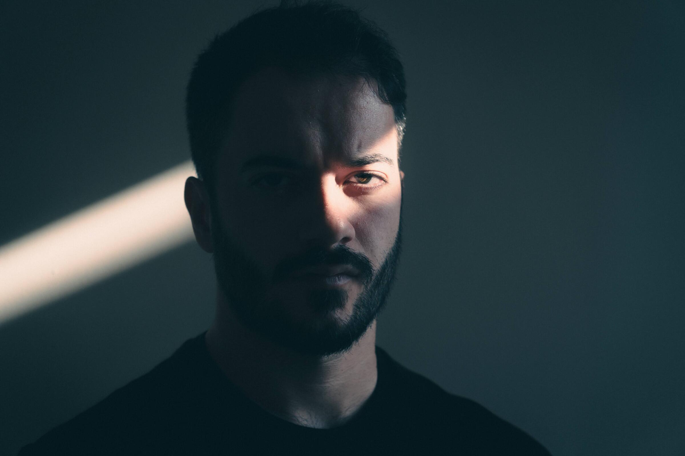

Hey,
My name is Abdussamet Koçak. I'm a developer based in Stuttgart, focusing mainly on web, but I also like writing scripts to automate anything and everything. I work as a backend web developer at refurbed.

I enjoy films, photography and nerding out on science and technology. I love learning new languages and cultures. Tatsächlich lerne ich seit Jahren gerne Deutsch. Über den Jahren, die ich in Deutschland verbracht habe, wurde mir klar dass die deutsche Sprache nicht so leicht zu beherrschen ist, aber ich liebe die Herausforderung.

You can react out to me about anything at [hey@abdus.dev](mailto:hey@abdus.dev).

<link rel="stylesheet" href="about.css">

<figure class="portrait-effect">
  

    
    <canvas class="portrait-effect__canvas" aria-hidden="true"></canvas>
  

  <noscript></noscript>
</figure>

