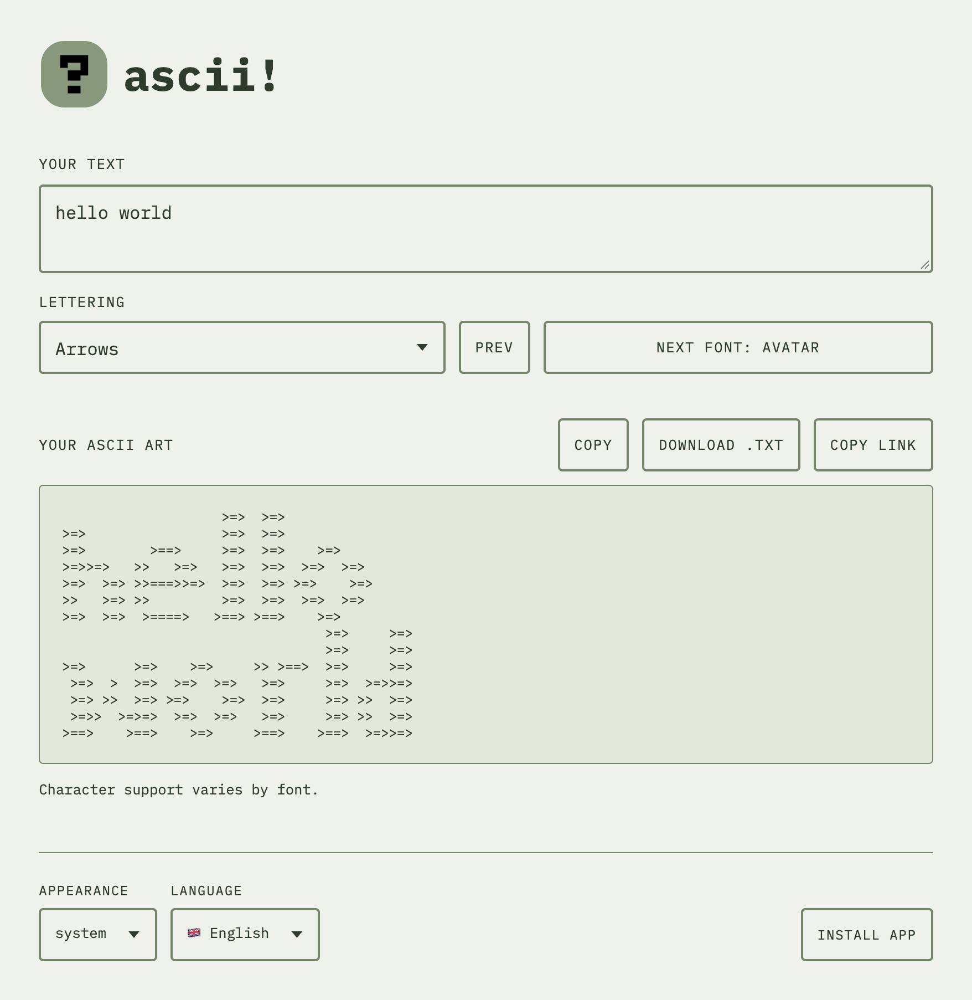

This is a simple PWA app for [figlet][figlet] to generate ASCII word art with hundreds of fonts to choose from. It uses [figlet.js][figlet.js] library to render ASCII text.





The app is reachable [here][addr]. The source is available on:

{{ gitea_repo(repo="abdus/ascii-pwa") }}

[addr]: https://artscii-abdusdev.vercel.app/
[figlet]: http://www.figlet.org/
[figlet.js]: https://github.com/patorjk/figlet.js
