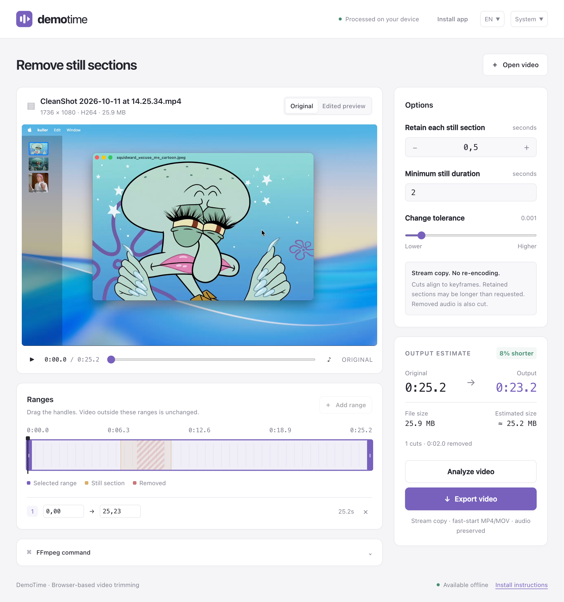

I've built this app for myself to trim down demo videos by cutting off sections where nothing happens, e.g. when waiting for a command to finish.

I could use a video editor for this, but I don't want to spend time picking out the sections manually. Turns out ffmpeg has a filter for this. So I first built a Python script, then I quickly realized that this could be better off as a web app.

{{ github_repo(repo="abdusco/demotime") }}

The app is deployed as a PWA, so you can install it on your device. It's available at <https://demotime.pages.dev>
