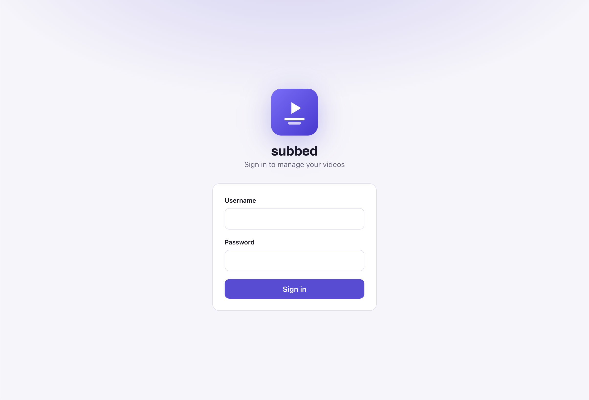
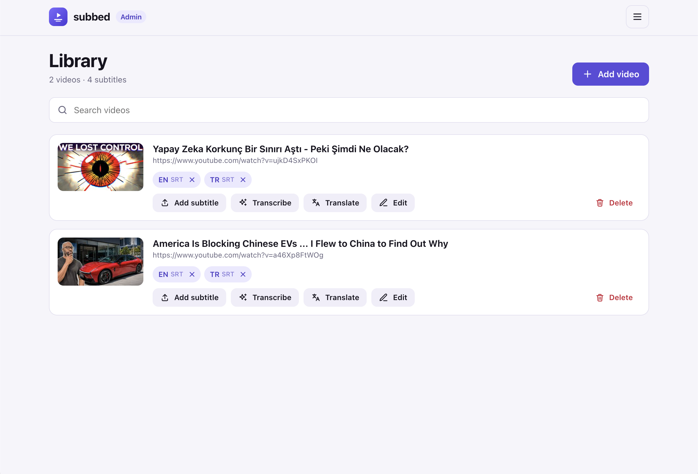
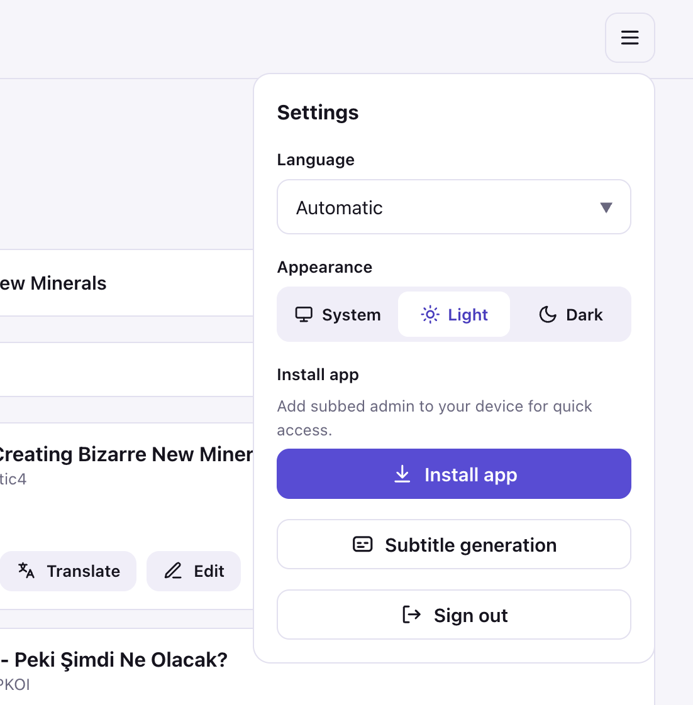
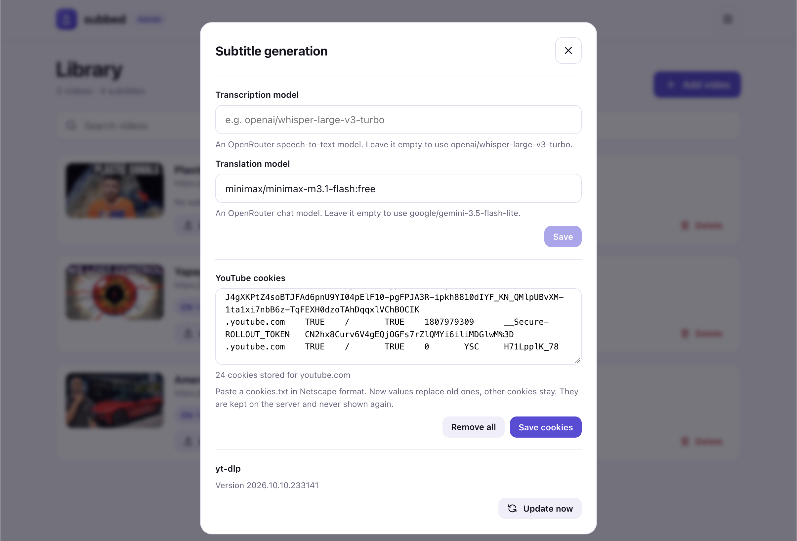
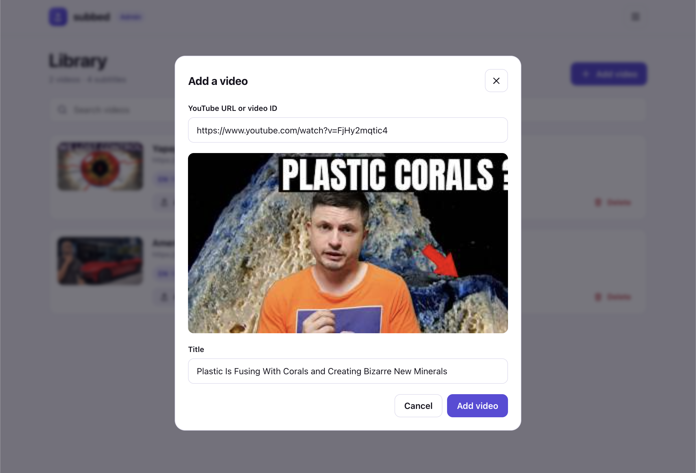

I've created this app to share videos with my friends who don't speak English. It lets you import a Youtube video, transcribe its audio into an SRT subtitle file, then translate it into different languages.

{{ github_repo(repo="abdusco/subbed") }}

It has a built-in player that overlays the subtitles on top of the video, so you can watch it as if the original creator had provided subtitles in your language. 

It uses [`yt-dlp`](https://github.com/yt-dlp/yt-dlp) under the hood. So you have to copy over your Youtube cookies to download the audio. You can also upgrade it to the latest nightly build when the existing version stops working. 

The app also lets you use custom models from OpenRouter to transcribe the audio and translate the subtitles.



<video src="./subbed_transcript.mp4" controls playsinline preload="metadata"></video>
<video src="./subbed_translate.mp4" controls playsinline preload="metadata"></video>

