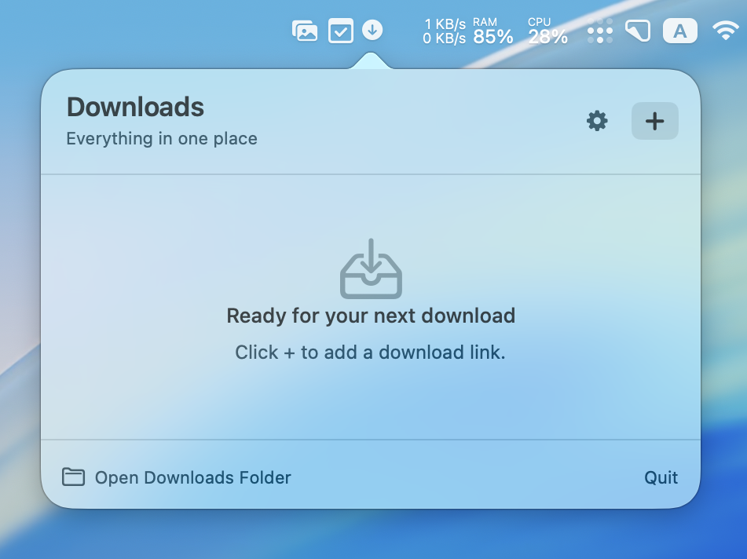
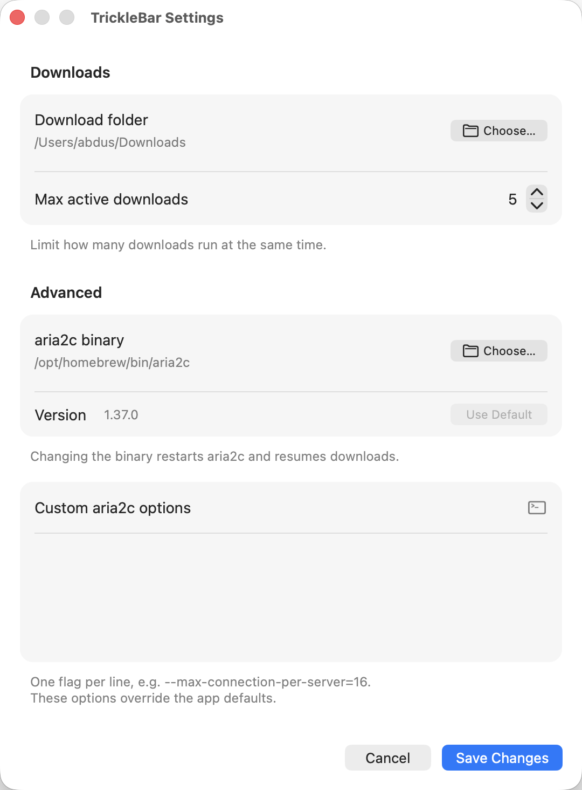

<div class="app-logo"></div>

<style>
.app-logo {
    width: 8rem;
    height: 8rem;
    margin-bottom: 2rem;
}
</style>

TrickleBar is a menu app based on [aria2][aria2] that provides a minimal interface to view and manage your downloads.
It requires aria2 to be installed and available in `$PATH` or other common locations, but you can also override which aria2 binary to use. It has a minimal settings panel to configure aria2 options. 






{{ github_repo(repo="abdusco/tricklebar") }}

It also provides a CLI that allows you to add new downloads, and passes the extra switches to aria2c. 

```bash
> TrickleBar.app/Contents/MacOS/TrickleBar --help
tricklebar — aria2c-compatible download manager

Usage:
  tricklebar [options] URL...     Add download(s) to running daemon
  tricklebar -i FILE              Read URLs from file
  open TrickleBar.app             Launch menu bar interface

Options (subset of aria2c flags):
  -d, --dir=DIR                Download directory
  -o, --out=FILE               Output filename
  -s, --split=N                Connections per download
  -x, --max-connection-per-server=N
  ...
  -h, --help
  -v, --version
```

It listens to `tricklebar://` URLs to add downloads. You can even specify which script to run when a download is done. I use it to automatically move the downloaded file to the right folder and show a notification, for example.

```bash
url="$1"
encoded=$(python3 -c "import urllib.parse, sys; print(urllib.parse.quote(sys.argv[1]))" "$url")
open "tricklebar://add-download?on_done=$HOME/bin/aria2_on_done.py&url=$encoded"
```

You can download the [latest version] from GitHub.

[latest version]: https://github.com/abdusco/tricklebar/releases/latest
[aria2]: https://aria2.github.io/
